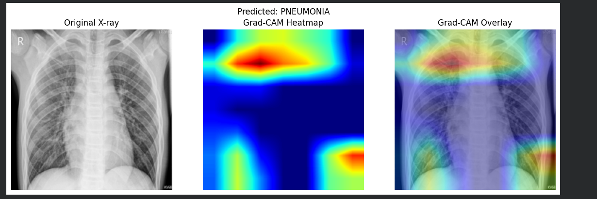
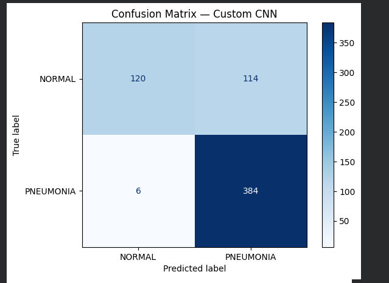
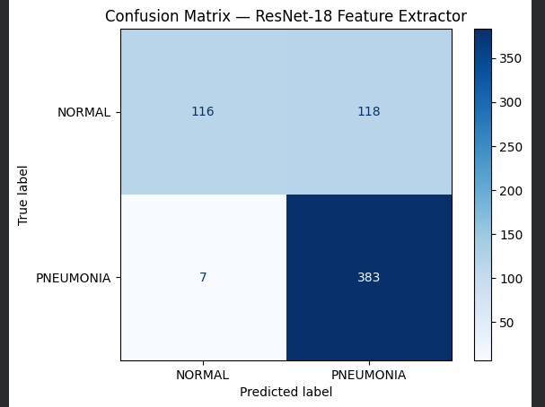
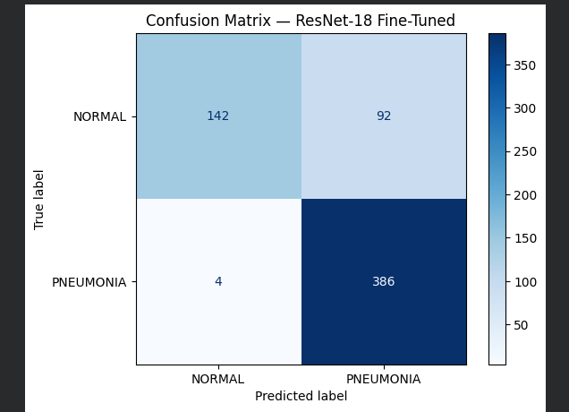

# Pneumonia Detection Using Deep Learning

A deep learning-based medical image classification project that identifies Normal and Pneumonia cases from chest X-ray images using Convolutional Neural Networks (CNNs) and transfer learning.

## Project Overview

This project explores the application of deep learning in medical image classification. Three model configurations were implemented and compared:

- Custom CNN trained from scratch
- ResNet-18 with a frozen backbone (feature extraction)
- Fine-tuned ResNet-18

The project was implemented using Python and PyTorch in Google Colab.

## Objectives

- Develop an automated chest X-ray image classification pipeline.
- Compare a custom CNN with pretrained ResNet-18.
- Evaluate model performance using multiple classification metrics.
- Apply Grad-CAM to visualize regions influencing model predictions.

## Dataset

**Dataset:** Chest X-Ray Images (Pneumonia) – Kaggle

- Training and validation images: 5,216
- Official test images: 624
- Classes: NORMAL and PNEUMONIA

The original training data was divided into training and validation sets using a stratified split.

## Technologies Used

- Python
- PyTorch
- Torchvision
- NumPy
- Pandas
- Matplotlib
- Scikit-learn
- Google Colab

## Methodology

1. Load and preprocess chest X-ray images.
2. Resize images to 224 × 224 pixels.
3. Apply data augmentation and normalization.
4. Train a custom CNN architecture.
5. Implement transfer learning using ResNet-18.
6. Fine-tune the pretrained model.
7. Evaluate models using a separate test dataset.
8. Apply Grad-CAM for model explainability.

## Model Performance

| Model | Validation Accuracy | Test Accuracy |
|---|---:|---:|
| Custom CNN | 95.66% | 80.77% |
| ResNet-18 Frozen | 94.46% | 79.97% |
| ResNet-18 Fine-tuned | 98.48% | 84.62% |

### Best Performing Model: Fine-tuned ResNet-18

- Test Accuracy: 84.62%
- Sensitivity: 98.97%
- Specificity: 60.68%
- F1-score: 88.94%
- ROC-AUC: 0.9543

The fine-tuned ResNet-18 achieved the highest test accuracy among the three models. Its high sensitivity indicates strong identification of pneumonia cases, while its lower specificity highlights the need to reduce false-positive predictions.

## Explainability

Grad-CAM was used to generate visual heatmaps highlighting image regions that influenced model predictions.

## How to Run

1. Clone this repository.
2. Install the required Python libraries.
3. Download the dataset from Kaggle.
4. Update the dataset path in the notebook.
5. Open the notebook in Google Colab or Jupyter Notebook.
6. Execute the notebook cells sequentially.

## Limitations and Future Scope

- Improve specificity and reduce false-positive predictions.
- Experiment with additional CNN architectures.
- Evaluate on larger and more diverse datasets.
- Validate model performance on external datasets.

## Disclaimer

This project is developed for academic and educational purposes. It is not a certified medical diagnostic system and should not be used for clinical decision-making.
## Results and Visualizations

### 1. Grad-CAM Explainability

The Grad-CAM visualization highlights image regions that influence the model's pneumonia prediction.

### 2. Confusion Matrix – Custom CNN

### 3. Confusion Matrix – ResNet-18 Feature Extractor

### 4. Confusion Matrix – Fine-tuned ResNet-18

